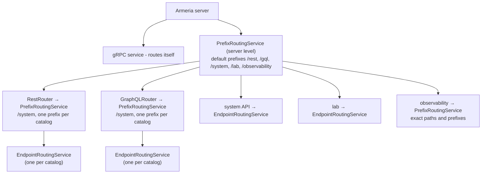

# HTTP request routing

This document explains how the evitaDB web server decides which handler serves an HTTP request or a WebSocket. It
covers the five classes in the package `io.evitadb.externalApi.http.routing`:

| Class | Job |
|---|---|
| <SourceClass>evita_external_api/evita_external_api_core/src/main/java/io/evitadb/externalApi/http/routing/PrefixRoutingService.java</SourceClass> | picks a handler by a literal path prefix; the only router that changes at runtime |
| <SourceClass>evita_external_api/evita_external_api_core/src/main/java/io/evitadb/externalApi/http/routing/EndpointRoutingService.java</SourceClass> | picks the endpoint by HTTP method and path template (`/product/{id}`); immutable |
| <SourceClass>evita_external_api/evita_external_api_core/src/main/java/io/evitadb/externalApi/http/routing/RegionRoutingTable.java</SourceClass> | hash table that looks up a piece of the request path without copying it |
| <SourceClass>evita_external_api/evita_external_api_core/src/main/java/io/evitadb/externalApi/http/routing/RoutingPath.java</SourceClass> | scans, splits, validates and decodes the encoded request path |
| <SourceClass>evita_external_api/evita_external_api_core/src/main/java/io/evitadb/externalApi/http/routing/RouteParameters.java</SourceClass> | carries the values captured from the path to the handler |

Why evitaDB routes requests itself instead of using Armeria's routing, which alternatives were rejected, and the
benchmark numbers are recorded in the decision record
[Route external API requests with own copy-on-write routers](../../adr/2026-11-14-copy-on-write-path-routing.md).
This document describes how the routers work today.

## The two requirements that shape everything

1. **Changing one catalog's endpoints must never disturb another catalog.** Catalogs are created, renamed, replaced
   and dropped while the server runs, and each change adds, rebuilds or removes that catalog's REST and GraphQL
   routes (a GraphQL schema refresh only swaps the GraphQL instance behind the routes it keeps). A request
   to any other catalog must keep working during the change, and a replaced catalog must never look missing (404)
   for a moment.
2. **Routing runs on every request,** so it must be fast and allocate as little as possible. Most lookups in the
   routers allocate nothing at all.

The first requirement leads to *copy-on-write* publication (see [Publishing a change](#publishing-a-change)), the
second to the allocation-free techniques described in [Looking up a piece of the path](#looking-up-a-piece-of-the-path)
and [Scanning the request path](#scanning-the-request-path).

## The routing tree

Armeria hands a request to evitaDB's routing tree unless a service that routes requests by itself claims it - gRPC
is registered directly on the Armeria server and never passes through these classes. Every other API is reached
through at most two prefix levels. Below them, REST, GraphQL, lab and the system API select their handler with one
endpoint router; observability binds its handlers directly to its prefix router:

The server-level prefix router is built by
<SourceClass>evita_external_api/evita_external_api_core/src/main/java/io/evitadb/externalApi/http/ExternalApiServer.java</SourceClass>
from the providers' `PathHandlingMode.DYNAMIC_PATH_HANDLING` services. Only the catalog level below REST and GraphQL
changes while the server runs.

### A request, step by step

Take `GET /rest/evita/product/get?primaryKey=1`:

1. The server-level prefix router scans the path once (see [Scanning the request path](#scanning-the-request-path)),
   stops at `?`, and finds the longest registered prefix that ends on a segment boundary: `/rest`. It passes the
   rest of the path, `/evita/product/get`, down as the request's `:path`. The query is not part of the new `:path`;
   handlers read it from `ServiceRequestContext#query()`, which still holds the original.
2. The REST router's prefix router does the same with the catalog prefixes and selects `/evita`. Its remainder is
   `/product/get`.
3. The catalog's endpoint router takes the trie for `GET`, follows the literal `product`, then the literal `get`,
   and finds the endpoint's handler there. The handler receives the original request unchanged.

## Scanning the request path

Every router starts with
`RoutingPath#scan`. One pass over the request path

- stops at the first real `?` (the start of the query),
- remembers where the path ends **without** its trailing slashes, so `/rest/evita/` and `/rest/evita` route the
  same way without creating a trimmed copy,
- remembers whether the path contains any `%` escape.

When the path contains one, a second pass starting at the first `%` checks that every escape is well formed and that
the escaped bytes are valid UTF-8. Neither pass allocates.

It returns all of that in one `long`, packed by the shared `NumberUtils#pack(int, int)`: the end position in the
high 32 bits, the "contains an escape" flag (1 or 0) in the low 32 bits, or `-1` when an escape is broken. A
packed result is never negative, because the end is not, so `-1` cannot be mistaken for a real result. The routers
read the two halves back with `NumberUtils#unpackHigh` and `NumberUtils#unpackLow`. Packing two results into a
primitive instead of returning a small object avoids one allocation per request. `RoutingPath#segment` uses the
same packing to report where one segment ends and whether that segment contains an escape.

### Why routing happens on the encoded path

The path that Armeria hands over is still percent-encoded: a client that wants a slash or a question mark *inside*
a value writes `%2F` or `%3F`. [RFC 3986, section 2.4](https://www.rfc-editor.org/rfc/rfc3986#section-2.4)
requires that a URI is split into its parts before the escapes inside them are decoded, otherwise a decoded `%2F`
would become a real separator. The routers therefore find the `/` and `?` delimiters on the encoded text and decode
only what lies between them, and only once:

- a segment without `%` is used as it is,
- a segment with `%` is decoded as strict UTF-8 (`RoutingPath#decode`), and a broken escape or invalid UTF-8 makes
  the router answer 404,
- `+` stays a plus sign. Turning `+` into a space is a convention of HTML form encoding
  ([`application/x-www-form-urlencoded`](https://url.spec.whatwg.org/#application/x-www-form-urlencoded)), not of
  URI paths.

Registered prefixes and templates are stored *decoded*, so a prefix registered as `/my catalog` matches the request
path `/my%20catalog`. The design relies on Armeria's own normalisation of the request path, as the decision record
established by reading Armeria 1.43's source: it keeps `%2F` and `%3F` escaped, decodes escaped unreserved
characters, collapses a raw `//` and rejects dot segments (`..`, also `%2e%2e`) and malformed `%` triplets (with 400)
before routing. Recheck these assumptions when upgrading Armeria.

### Validating UTF-8 without decoding

`RoutingPath#valid` walks the escapes from the first `%` and checks each escaped byte against the table of
well-formed UTF-8 sequences in [RFC 3629, section 4](https://www.rfc-editor.org/rfc/rfc3629#section-4):

| First byte | Bytes in the sequence | Allowed range of the second byte |
|---|---|---|
| `00`-`7F` | 1 | - |
| `C2`-`DF` | 2 | `80`-`BF` |
| `E0` | 3 | `A0`-`BF` (rejects overlong forms) |
| `E1`-`EC`, `EE`-`EF` | 3 | `80`-`BF` |
| `ED` | 3 | `80`-`9F` (rejects UTF-16 surrogates `D800`-`DFFF`) |
| `F0` | 4 | `90`-`BF` (rejects overlong forms) |
| `F1`-`F3` | 4 | `80`-`BF` |
| `F4` | 4 | `80`-`8F` (rejects code points above `U+10FFFF`) |

Every further byte of a sequence must be `80`-`BF`; the bytes `80`-`C1` and `F5`-`FF` never start a sequence. The
check keeps only three integers - how many continuation bytes are still expected and the allowed range of the next
one - so it allocates nothing. A raw character (a `/`, for example) in the middle of a sequence fails it.

## The prefix router

`PrefixRoutingService` maps literal paths to handlers. For each request it tries, in this order:

1. an **exact path** registered with `addExactPath` - it matches only the whole request path;
2. the **longest prefix** that ends on a segment boundary of the request path - `/foo` matches `/foo` and
   `/foo/bar`, never `/foobar` (the [longest prefix match](https://en.wikipedia.org/wiki/Longest_prefix_match)
   familiar from IP routing);
3. the **default** registered under `/`, which consumes nothing and receives the whole path.

Nothing matched answers 404 for HTTP and closes a WebSocket with code 1008, "policy violation"
([RFC 6455, section 7.4.1](https://www.rfc-editor.org/rfc/rfc6455#section-7.4.1)). The prefix router does not look
at the HTTP method; answering 405 is the endpoint router's job.

### Finding the longest prefix

For a path without escapes, every published table keeps the distinct lengths of its prefixes sorted from the
longest to the shortest. The lookup walks this short list and, for each length, first checks the boundary (the
path ends there or the next character is `/`) and only then probes the hash table with that piece of the path. The
first hit is the longest match. With a handful of distinct prefix lengths this is a handful of probes, no matter how
many catalogs are registered.

A path with escapes cannot be compared character by character with the decoded prefixes, because `%20` is three
characters on the wire and one in the prefix. For that case the table also keeps a small tree of decoded segments.
The lookup walks it segment by segment, comparing decoded characters without creating decoded strings, and
remembers the deepest prefix seen on the way. Because the matched prefix is then shorter in the decoded form than in
the request, the router recomputes how much of the *raw* path it consumed by counting the prefix's segments along the
raw slashes (`PrefixRoutingService#consumed`).

### Publishing a change

Any thread may add, replace or remove a prefix while requests are being served. The router uses
[copy-on-write](https://en.wikipedia.org/wiki/Copy-on-write):

1. a writer takes a `ReentrantLock`, so that no two changes start from the same table;
2. it copies the current bindings into new maps and applies its one change;
3. it compiles a complete new, immutable table from them;
4. it publishes the table with a single write to a `volatile` field.

A request reads that field exactly once and uses the table it got for the whole lookup, so it never needs a lock
and never sees a half-made change. A request already in flight keeps the bindings it started with. The `volatile`
write and read are what make the new table, and everything reachable from it, visible to other threads: a write to
a volatile field *happens before* every later read of it
([JLS 17.4.4](https://docs.oracle.com/javase/specs/jls/se21/html/jls-17.html#jls-17.4.4),
[17.4.5](https://docs.oracle.com/javase/specs/jls/se21/html/jls-17.html#jls-17.4.5)). The same idea is behind the
JDK's [`CopyOnWriteArrayList`](https://docs.oracle.com/en/java/javase/21/docs/api/java.base/java/util/concurrent/CopyOnWriteArrayList.html).

The new table reuses the handler object of every path the change did not name. That is the isolation guarantee:
replacing catalog A creates a new binding for A only, and catalog B's requests keep reaching the very same handler.
A replacement is a single publication, so the replaced catalog is never missing in between.

The price is paid by writers: each change copies and recompiles the whole table, so its cost grows with the number
of catalogs (the decision record measured 19 µs at 10 catalogs and 29 µs at 100). Writes happen only when a catalog
changes, reads on every request, so this trade is deliberate.

## Looking up a piece of the path

Both routers look up names by a *region* of the request path - "characters 6 to 11" - instead of cutting that region
out into a new `String`. `RegionRoutingTable` makes this possible:

- It is an [open-addressing hash table with linear probing](https://en.wikipedia.org/wiki/Linear_probing): keys and
  values sit in two plain arrays, and a collision moves on to the next slot.
- The capacity is the smallest power of two that is at least twice the number of keys, and at least two, so at most
  half of the slots are used. A slot index is computed with `hash & (capacity - 1)` instead of a slower remainder,
  and every search for a missing key is guaranteed to reach a free slot and stop. At this load, and with
  well-distributed hashes, linear probing needs on average about 1.5 probes to find a key and 2.5 probes to conclude
  that it is absent (Knuth, *The Art of Computer Programming*, Vol. 3, section 6.4, Algorithm L). This is an
  average, not a bound: keys whose `String` hashes collide still probe one after another.
- The hash of a region is `String#hashCode` computed over the region's characters, followed by the bit spread
  `h ^ (h >>> 16)` that `java.util.HashMap` uses to mix the high bits into the low ones. The key comparison is
  `String#regionMatches`. Nothing is allocated.
- For a segment that contains escapes, `getEscaped` computes the hash of the **decoded** text on the fly
  (`RoutingPath#decodedHash`) and compares decoded characters with the key (`RoutingPath#decodedEquals`). A code
  point above `U+FFFF` is counted as its two UTF-16 surrogates, exactly as Java strings store it, so the decoded hash
  equals the plain `String#hashCode` of the decoded key. `getEscaped` then applies the same bit spread to it. The
  table relies on this: a stored key, a plain region and an escaped region with the same decoded text must all end
  with the same spread hash, or a stored key could not be found again.

The table is built once and never changed, which is why it can be shared by all threads without a lock.

## The endpoint router

`EndpointRoutingService` matches the rest of the path against endpoint *templates*. A template consists of whole
segments: literals (`product`), parameters (`{primaryKey}`) and, as the very last segment, a wildcard `*`.

### One trie per HTTP method

The templates are stored in a [trie](https://en.wikipedia.org/wiki/Trie), a tree in which each level is one path
segment. Each node has

- a hash table of literal children (a `RegionRoutingTable`),
- at most one parameter child, shared by all parameter names at that position,
- the route that ends at this node, if any,
- the route whose final `*` starts at this node, if any.

There is a separate trie for every HTTP method. With one shared trie, a lookup could stop at a more specific route
that exists only for another method. The decision record gives a real example from generated REST endpoints: with
collections named `en` and `get`, GET `/en/get/{primaryKey}` and POST `/{locale}/get/list` exist, and POST
`/en/get/list` must reach the second route.

### Matching order and backtracking

At every node the router tries the literal child first, then the parameter child, then the wildcard. If a branch
fails deeper down, it backs out and tries the next option (`EndpointRoutingService#find`). So `/a/new` prefers a
template `/a/new` to `/a/{id}`, but `/a/new/edit` still reaches `/a/{id}/edit` when `/a/new` has no `edit` child.
Backtracking cannot blow up: every node of the trie has exactly one parent, and a node is entered only from its
parent's single visit, so one request visits each node at most once. The work is bounded by the size of the trie,
never by trying combinations.

A wildcard matches the rest of the path, slashes included; the matched tail is not exposed as a captured value. It
needs at least one more segment: `/a/*` does not match `/a`, while `/*` also matches `/`. A parameter needs one more
segment too and gets no such
exception, so `/{id}` does not match `/`. To keep the rules unambiguous, a node with a wildcard may
have nothing else - no literal or parameter child and no route ending there; the builder rejects such templates in
either registration order.

### 405 Method Not Allowed

The tries of other methods are searched only after the request's own method missed - an error path, so it may cost
more. If some of them match, the answer is 405 with exactly those methods in the `Allow` header, as
[RFC 9110, section 15.5.6](https://www.rfc-editor.org/rfc/rfc9110#section-15.5.6) requires; otherwise it is 404.

### WebSockets

A WebSocket opens with a GET upgrade over HTTP/1.1 ([RFC 6455](https://www.rfc-editor.org/rfc/rfc6455#section-4.1))
and with an extended CONNECT over HTTP/2 ([RFC 8441](https://www.rfc-editor.org/rfc/rfc8441#section-4)). When a GET
handler is also a `WebSocketHandler`, the builder therefore registers the same template for CONNECT as well. This
automatic CONNECT twin routes like any other route but never appears in `Allow` and never turns a 404 into a 405.

### Captured values

The values of `{name}` segments are extracted only after a route has been chosen, so a branch the router backed out
of costs no decoding. Each route remembers which segment positions it captures (`captureSegments`); the names live
on the route, not on the node, because two routes may share a parameter node but spell the parameter differently
(`/a/{x}/one` and `/a/{z}/three`). The values are decoded once and attached to the request context under
`RouteParameters.KEY`; the REST handler reads them from there, together with the query from `ctx.query()`. Client
headers can never supply them. This happens for HTTP requests only: a WebSocket handler selected by the same router
receives no captured values, and no production WebSocket route has a parameter.

### Building and publishing

An endpoint router is built completely by its `Builder` and never changes afterwards; every field is final. It
becomes visible to request threads through the prefix router's volatile table, so it needs no lock of its own. The
builder validates templates before touching the trie: a trailing slash (except for `/`), `?`, a repeated parameter
name, a partial parameter (`{x}tail`) or a wildcard that is not the last segment is rejected with
`GenericEvitaInternalError`. Registering the same template twice keeps the first handler, but only when it is
spelled with its leading slash: the builder stores `bare` as `/bare` and compares a repeated registration with its
spelling as given, so a second `bare` fails. Registering an equivalent template with different parameter names fails
as well.

## Rules for changing this code

- **A published table is never written again.** A writer builds a complete new table and assigns the field once.
  Assigning twice in one change (for example "remove, then add") reintroduces the moment in which the path is
  missing.
- **Keep the field `volatile`.** Without it, request threads may see a stale or partly built table. No test catches
  its removal reliably.
- **Reuse the handlers of unchanged paths.** Rebuilding or re-decorating them breaks the isolation between catalogs
  without failing any status-code assertion; the unit tests compare object identity for this reason.
- **A stored key, a plain region and an escaped region with the same decoded text must reach the same hash, with the
  bit spread applied exactly once.** `RoutingPath#decodedHash` returns the unspread hash and `getEscaped` spreads
  it; adding the spread inside `decodedHash` would apply it twice (see
  [Looking up a piece of the path](#looking-up-a-piece-of-the-path)).
- **Delimiters before decoding.** Never decode a whole path and split it afterwards.

## Tests

| Test | What it covers |
|---|---|
| <SourceClass>evita_test/evita_functional_tests/src/test/java/io/evitadb/externalApi/http/routing/RoutingPathTest.java</SourceClass> | scanning, UTF-8 validation, decoding |
| <SourceClass>evita_test/evita_functional_tests/src/test/java/io/evitadb/externalApi/http/routing/RegionRoutingTableTest.java</SourceClass> | region and escaped lookups |
| <SourceClass>evita_test/evita_functional_tests/src/test/java/io/evitadb/externalApi/http/routing/PrefixRoutingServiceTest.java</SourceClass> | precedence, remainders, publication and handler identity |
| <SourceClass>evita_test/evita_functional_tests/src/test/java/io/evitadb/externalApi/http/routing/EndpointRoutingServiceTest.java</SourceClass> | template grammar, matching order, 405, WebSockets, captures |

The long-running `LongRunningPrefixRoutingPublicationTest` and `LongRunningExternalApiChurnTest` check under load
that no request sees a missing route while catalogs change. The decision record lists further API-level tests and
the benchmark results.

## References

- [RFC 3986 - URI generic syntax](https://www.rfc-editor.org/rfc/rfc3986): percent-encoding (section 2.1) and
  splitting before decoding (section 2.4)
- [RFC 3629 - UTF-8](https://www.rfc-editor.org/rfc/rfc3629#section-4): well-formed byte sequences
- [RFC 9110 - HTTP semantics](https://www.rfc-editor.org/rfc/rfc9110#section-15.5.6): 405 and the `Allow` header
- [RFC 6455 - The WebSocket protocol](https://www.rfc-editor.org/rfc/rfc6455) and
  [RFC 8441 - WebSockets over HTTP/2](https://www.rfc-editor.org/rfc/rfc8441)
- [Java Language Specification, chapter 17 - threads and locks](https://docs.oracle.com/javase/specs/jls/se21/html/jls-17.html):
  volatile and happens-before
- [Linear probing](https://en.wikipedia.org/wiki/Linear_probing), [trie](https://en.wikipedia.org/wiki/Trie),
  [longest prefix match](https://en.wikipedia.org/wiki/Longest_prefix_match),
  [copy-on-write](https://en.wikipedia.org/wiki/Copy-on-write)
- [WHATWG URL Standard - `application/x-www-form-urlencoded`](https://url.spec.whatwg.org/#application/x-www-form-urlencoded):
  where `+` means a space, and where it does not apply
