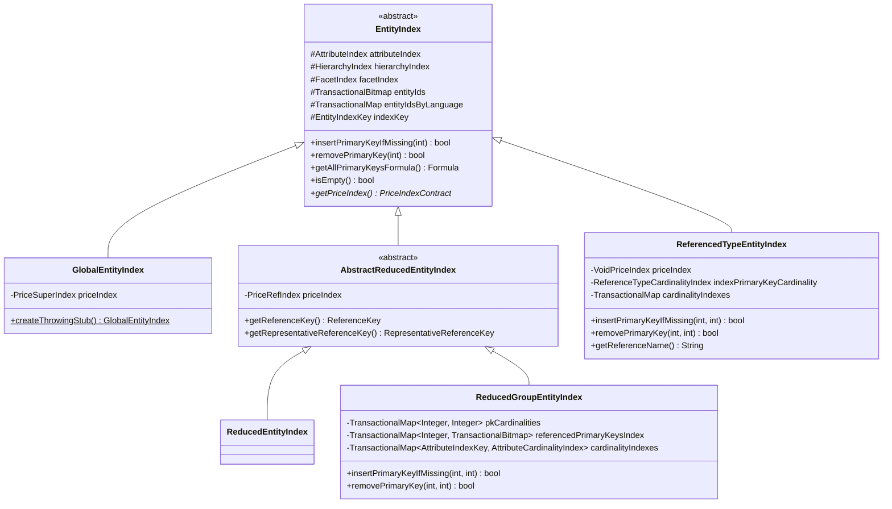

# The EntityIndex Hierarchy

This document describes the `EntityIndex` class hierarchy, the `EntityIndexType` enum, the
`EntityIndexKey` addressing scheme, the three concrete index implementations:
`GlobalEntityIndex`, `ReducedEntityIndex`, and `ReferencedTypeEntityIndex`, and the two forms a
reference partition takes -- a `ReducedEntityIndex`, or a row of the registry of single-owner partitions
(see [Reference Partitions](#reference-partitions-and-the-registry-of-single-owner-partitions)).

For the overall architecture context, see the [Overview](overview.md#overview).


## EntityIndexType Enum

`EntityIndexType` (in `io.evitadb.api.index`, so that the statistics API can report it without the
API module depending on `evita_engine`) defines all flavors of entity index. Each value maps
to a specific concrete class and discriminator type.

### GLOBAL

The primary index for an entity type. There is exactly **one**
<Term location="/documentation/developer/indexes/overview.md" name="Global Entity Index">`GlobalEntityIndex`</Term>
per entity type per
<Term location="/documentation/developer/indexes/overview.md" name="scope">`Scope`</Term>.
It contains the complete set of indexed data: all entity primary keys, all attribute
indexes (filter, sort, unique, chain), the full `PriceSuperIndex`, the `HierarchyIndex`, and the
`FacetIndex`.

When the query planner cannot narrow the search to a more specific index, it falls back to the
global index -- analogous to a full table scan in a relational database, though still operating on
pre-built bitmap structures.

**Discriminator:** `null`

### REFERENCED_ENTITY_TYPE

A type-level index that exists once per reference name (e.g., one for "brand", one for "category").
It is backed by
<Term location="/documentation/developer/indexes/overview.md" name="Referenced Type Entity Index">`ReferencedTypeEntityIndex`</Term>
and holds:

- **Reference attribute filter indexes** -- filter indexes for
  <Term location="/documentation/developer/indexes/overview.md" name="reference attribute">reference attributes</Term>
  defined on the relation, with cardinality tracking via `AttributeCardinalityIndex`
- **`ReferenceTypeCardinalityIndex`** -- tracks how many owning entities contribute to each
  partition PK entry in this type index. A partition PK is added to `entityIds`
  on first insertion and removed only when its cardinality drops to zero.
- **Entity ID bitmap** -- contains the primary keys of the reference's partitions (one per
  `RepresentativeReferenceKey`) for this reference name, whether the partition is a
  `ReducedEntityIndex` or a registry row. Unlike `GlobalEntityIndex` and `ReducedEntityIndex` which
  store owning entity PKs, this index stores internal partition PKs assigned via `indexPkSequence`
  -- the storage PK of the `ReducedEntityIndex`, or the PK a registry row carries. The
  `ReferenceTypeCardinalityIndex` provides the mapping between these partition PKs and the actual
  referenced entity PKs.
- **Registry of single-owner partitions** -- a `VirtualReferencePartitionIndex` holding a row for
  every partition with a single owner of a reference indexed `FOR_FILTERING`
  (see [Reference Partitions](#reference-partitions-and-the-registry-of-single-owner-partitions)).

It does **not** hold sort indexes (because a single entity may reference multiple targets, making
sort ordering ambiguous), price indexes (delegates to `VoidPriceIndex`), or hierarchy data.

This index is used when the query contains a `ReferenceHaving` constraint and needs to resolve
reference attribute filters without iterating individual reduced indexes.

**Discriminator:** `String` -- the `ReferenceSchemaContract.getName()` value

### REFERENCED_ENTITY

A per-target-entity index backed by
<Term location="/documentation/developer/indexes/overview.md" name="Reduced Entity Index">`ReducedEntityIndex`</Term>.
It is the index-object form of a reference partition -- the owners of one combination of (reference
name, referenced entity primary key, representative attribute values). Every partition a reference
indexed `FOR_FILTERING_AND_PARTITIONING` creates has one, and so has every partition with two or more
owners of a reference indexed `FOR_FILTERING`; a partition with a single owner of the latter is a
row of the registry of single-owner partitions instead and has no `ReducedEntityIndex`
(see [Reference Partitions](#reference-partitions-and-the-registry-of-single-owner-partitions)).
It contains:

- **Entity ID bitmap** -- primary keys of
  <Term location="/documentation/developer/indexes/overview.md" name="owning entity">**owning** entities</Term>
  that hold a reference to this specific target (same semantics as `GlobalEntityIndex` -- these are
  the indexed entity's PKs, not the target entity's PK)
- **Reference attribute indexes** -- filter and sort indexes for the
  <Term location="/documentation/developer/indexes/overview.md" name="reference attribute">reference's attributes</Term>
- **Entity attribute indexes** --
  <Term location="/documentation/developer/indexes/overview.md" name="entity attribute">entity attributes</Term>
  replicated from the global index, only when `ReferenceIndexType` is `FOR_FILTERING_AND_PARTITIONING`
  (see [schema-settings.md](schema-settings.md#reference-index-type))
- **`PriceRefIndex`** -- a lightweight
  <Term location="/documentation/developer/indexes/overview.md" name="price record sharing">price-sharing index</Term>
  that reuses price record instances from the global `PriceSuperIndex` without duplicating them;
  only when `ReferenceIndexType` is `FOR_FILTERING_AND_PARTITIONING`
- **Facet data** -- for cross-reference facet queries; only when `ReferenceIndexType` is
  `FOR_FILTERING_AND_PARTITIONING`
- **Hierarchy data** -- hierarchy placement data for referenced entities that have
  `isWithHierarchy()` enabled

This is the **workhorse index for reference-based queries**. When a query filters by a specific
referenced entity (e.g., "products in category 42"), the query planner selects the
<Term location="/documentation/developer/indexes/overview.md" name="partitioned view">reduced index</Term>
keyed to that entity, instantly narrowing the search space to a pre-filtered bitmap; a partition kept
as a registry row contributes its single owner read out of the row.

**Discriminator:**
<Term location="/documentation/developer/indexes/overview.md" name="Representative Reference Key">`RepresentativeReferenceKey`</Term>
-- combines the reference name, the referenced entity primary key, and an ordered array of
representative attribute values that distinguish multiple references of the same type to the same
target.

### REFERENCED_HIERARCHY_NODE (removed)

Previously a dedicated index for hierarchical references. Merged into `REFERENCED_ENTITY` in 2024.12
because it contained the same data without additional value, and dropped from the enum once nothing
produced it. It survives only as a **name on disk**: a catalog written before the merge still spells
it, and `EntityIndexTypeSerializer` folds it into `REFERENCED_ENTITY` on read. Nothing in the engine
can name it any more.

### REFERENCED_GROUP_ENTITY_TYPE

Analogous to `REFERENCED_ENTITY_TYPE` but partitions by the **group entity** rather than the
referenced entity. Backed by
<Term location="/documentation/developer/indexes/overview.md" name="Referenced Type Entity Index">`ReferencedTypeEntityIndex`</Term>.
Created when the schema includes `ReferenceIndexedComponents.REFERENCED_GROUP_ENTITY` in the
reference's indexed components configuration
(see [schema-settings.md](schema-settings.md#reference-indexed-components)).

Used when the query contains a `GroupHaving` constraint and needs to resolve
<Term location="/documentation/developer/indexes/overview.md" name="reference attribute">reference attribute</Term>
filters partitioned by group.

**Discriminator:** `String` -- the `ReferenceSchemaContract.getName()` value

### REFERENCED_GROUP_ENTITY

A per-referenced-entity index for **group-based queries**, backed by
`ReducedGroupEntityIndex`. Unlike `ReducedEntityIndex`, this class adds **cardinality tracking**
for both primary keys and filter attributes. This is necessary because multiple references from
different
<Term location="/documentation/developer/indexes/overview.md" name="owning entity">owning entities</Term>
can share the same group, causing the same entity primary key and attribute values to be indexed
multiple times into the same group-level index.

The index is keyed by the **same**
<Term location="/documentation/developer/indexes/overview.md" name="Representative Reference Key">
`RepresentativeReferenceKey`</Term> as `REFERENCED_ENTITY` -- the referenced entity PK, not the
group PK. The group PK is tracked **internally** by `ReducedGroupEntityIndex` via its
`referencedPrimaryKeysIndex` (which maps referenced entity PKs to bitmaps of owning entity PKs)
and `pkCardinalities` (which tracks how many times each owning entity PK was added).

**Why keyed by referenced entity PK, not group PK?** Reference attributes are per-reference —
each reference to a different target entity can carry distinct attribute values (e.g.
`basicUnitValue`, `quantity`). Keying by group PK would merge these into one index, making
per-reference filtering and sorting impossible. The `REFERENCED_GROUP_ENTITY_TYPE` type index
provides the necessary group → indexes mapping for `GroupHaving` queries, so group-level
semantics are preserved despite the per-reference keying.

The `entityIds` bitmap contains
<Term location="/documentation/developer/indexes/overview.md" name="owning entity">**owning** entity PKs</Term>
(same semantics as `REFERENCED_ENTITY`), but an owning entity PK is only added to the bitmap
when its cardinality transitions from 0 to 1, and only removed when it drops back to 0.

Key behavioral differences from `ReducedEntityIndex`:

- **No sort indexes** -- all sort methods are no-ops because an entity may reference multiple
  entities in the same group, making sort ordering ambiguous
- **No unique attributes** -- no-ops because multiple entities can reference the same group,
  making uniqueness checks inappropriate
- **Filter attributes use cardinality tracking** -- via `AttributeCardinalityIndex`, identical
  to the mechanism used in `ReferencedTypeEntityIndex`
- **Two-argument PK insertion/removal** -- `insertPrimaryKeyIfMissing(int, int)` and
  `removePrimaryKey(int, int)` require both the owning entity PK and the referenced entity PK;
  single-argument versions throw `UnsupportedOperationException`

**Discriminator:**
<Term location="/documentation/developer/indexes/overview.md" name="Representative Reference Key">`RepresentativeReferenceKey`</Term>
-- the same key as `REFERENCED_ENTITY`, combining the reference name, the **referenced** entity
primary key, and representative attribute values.


## EntityIndexKey

<Term location="/documentation/developer/indexes/overview.md" name="Entity Index Key">`EntityIndexKey`</Term>
is the record that uniquely addresses an `EntityIndex` within an entity collection. It is defined
as:

```java
public record EntityIndexKey(
    @Nonnull EntityIndexType type,
    @Nonnull Scope scope,
    @Nullable Serializable discriminator
) implements IndexKey, Comparable<EntityIndexKey>
```

### Addressing scheme

| `EntityIndexType` | `Scope` | `discriminator` type | Example |
|---|---|---|---|
| `GLOBAL` | LIVE or ARCHIVED | `null` | `(GLOBAL, LIVE, null)` |
| `REFERENCED_ENTITY_TYPE` | LIVE or ARCHIVED | `String` | `(REF_ENTITY_TYPE, LIVE, "brand")` |
| `REFERENCED_ENTITY` | LIVE or ARCHIVED | `RepresentativeReferenceKey` | `(REF_ENTITY, LIVE, {brand/42, []})` |
| `REFERENCED_GROUP_ENTITY_TYPE` | LIVE or ARCHIVED | `String` | `(REF_GROUP_TYPE, LIVE, "category")` |
| `REFERENCED_GROUP_ENTITY` | LIVE or ARCHIVED | `RepresentativeReferenceKey` | `(REF_GROUP, LIVE, {brand/42, []})` |

### Constructor validation

The constructor enforces strict type-safety between the `EntityIndexType` and the discriminator:

- **`GLOBAL`** requires `discriminator == null`. Any non-null value throws
  `GenericEvitaInternalError`.
- **`REFERENCED_ENTITY_TYPE`** and **`REFERENCED_GROUP_ENTITY_TYPE`** require a `String`
  discriminator (the reference name).
- **`REFERENCED_ENTITY`** and **`REFERENCED_GROUP_ENTITY`** require a
  <Term location="/documentation/developer/indexes/overview.md" name="Representative Reference Key">`RepresentativeReferenceKey`</Term>
  discriminator.
- Any other discriminator type throws `GenericEvitaInternalError`.

### Natural ordering

`EntityIndexKey` implements `Comparable`. The ordering is:

1. By `EntityIndexType` ordinal (GLOBAL < REFERENCED_ENTITY_TYPE < REFERENCED_ENTITY < ...)
2. Within the same type:
   - GLOBAL: by
     <Term location="/documentation/developer/indexes/overview.md" name="scope">`Scope`</Term>
     ordinal
   - `*_TYPE` variants: lexicographic by the `String` discriminator
   - `*_ENTITY` variants: by `RepresentativeReferenceKey.compareTo()`


## RepresentativeReferenceKey

The discriminator for `REFERENCED_ENTITY` and `REFERENCED_GROUP_ENTITY` indexes is a
<Term location="/documentation/developer/indexes/overview.md" name="Representative Reference Key">`RepresentativeReferenceKey`</Term>
record from `io.evitadb.api.requestResponse.data.structure`:

```java
public record RepresentativeReferenceKey(
    @Nonnull ReferenceKey referenceKey,
    @Nonnull Serializable[] representativeAttributeValues
) implements Serializable, Comparable<RepresentativeReferenceKey>
```

It combines:

- **`referenceKey`** -- the `(referenceName, primaryKey)` pair identifying the target (or group)
  entity
- **`representativeAttributeValues`** -- an ordered array of attribute values that serve as a
  domain-specific tie-breaker when multiple references share the same name and target PK

The constructor normalizes the `ReferenceKey` by stripping any extra flags (unless it is an
"unknown" reference), ensuring stable equality and hashing semantics for use as a map key.


## Class Hierarchy Diagram




## Summary Table

| EntityIndexType | Concrete Class | Discriminator | Price Index | Cardinality | Purpose |
|---|---|---|---|---|---|
| `GLOBAL` | `GlobalEntityIndex` | `null` | `PriceSuperIndex` | No | Authoritative complete index for entity type |
| `REFERENCED_ENTITY_TYPE` | `ReferencedTypeEntityIndex` | `String` | `VoidPriceIndex` | Yes | Type-level reference attribute filters |
| `REFERENCED_ENTITY` | `ReducedEntityIndex` | `RepresentativeReferenceKey` | `PriceRefIndex` | No | Per-target partitioned view for fast lookups |
| `REFERENCED_GROUP_ENTITY_TYPE` | `ReferencedTypeEntityIndex` | `String` | `VoidPriceIndex` | Yes | Group-level reference attribute filters |
| `REFERENCED_GROUP_ENTITY` | `ReducedGroupEntityIndex` | `RepresentativeReferenceKey` | `PriceRefIndex` | Yes (PK + attribute) | Per-group partitioned view with cardinality tracking |


## GlobalEntityIndex -- Deep Dive

<Term location="/documentation/developer/indexes/overview.md" name="Global Entity Index">`GlobalEntityIndex`</Term>
is the **single source of truth** for an entity type within a given
<Term location="/documentation/developer/indexes/overview.md" name="scope">scope</Term>.
It extends `EntityIndex` and adds:

- **`PriceSuperIndex`** -- the authoritative price index that **owns** all price record objects.
  Every `PriceRefIndex` in a `ReducedEntityIndex`
  <Term location="/documentation/developer/indexes/overview.md" name="price record sharing">shares price records</Term>
  stored here, avoiding duplicate memory allocations.
- **Throwing stub factory** -- `createThrowingStub()` produces a proxy that throws
  `EntityNotManagedException` for any method not explicitly handled. This is used when a
  referenced entity type is not managed by the current catalog but its primary keys are still
  needed for query resolution.

### Transactional behavior

On commit, `createCopyWithMergedTransactionalMemory()` produces a new `GlobalEntityIndex` with:
- Merged `entityIds` bitmap
- Merged `entityIdsByLanguage` map
- Merged `AttributeIndex`, `PriceSuperIndex`, `HierarchyIndex`, `FacetIndex`
- Version incremented by 1 if any change was detected (dirty flag was set)

### Test Blueprint Hints

- **Completeness:** After inserting an entity with attributes, prices, and references, the
  global index must contain the entity PK in `entityIds`, appropriate entries in the attribute
  filter/sort/unique indexes, price records in the `PriceSuperIndex`, and -- if the entity has
  locale-specific data -- the PK in the corresponding `entityIdsByLanguage` bitmap.
- **Emptiness after removal:** Removing all entities must result in `isEmpty() == true`, which
  checks `entityIds`, `entityIdsByLanguage`, `facetIndex`, `attributeIndex`,
  `hierarchyIndex`, AND `priceIndex`.
- **Stub behavior:** Calling any data-access method on a throwing stub (except `getIndexKey()`,
  `getAllPrimaryKeys()`, and `Object` methods) must throw `EntityNotManagedException`.


## ReducedEntityIndex -- Deep Dive

<Term location="/documentation/developer/indexes/overview.md" name="Reduced Entity Index">`ReducedEntityIndex`</Term>
is the
<Term location="/documentation/developer/indexes/overview.md" name="partitioned view">**partitioned view**</Term>
that enables O(bitmap-intersection) lookups for reference-based queries. It extends
`AbstractReducedEntityIndex` (which itself extends `EntityIndex`) and adds no additional fields
beyond the shared base. Its sibling class `ReducedGroupEntityIndex` handles `REFERENCED_GROUP_ENTITY`
indexes with cardinality tracking (see below).

`AbstractReducedEntityIndex` provides:

- **`PriceRefIndex`** -- a lightweight price index that delegates to the global
  `PriceSuperIndex` for actual price record storage. It maintains its own
  `PriceListAndCurrencyPriceRefIndex` sub-indexes keyed by `(priceList, currency)` but reuses
  the price record instances.

### What data it holds

| Data | When present |
|------|-------------|
| Entity IDs referencing a specific target | Always |
| Reference attribute filter/sort indexes | Always (if attributes exist on the reference) |
| Entity attribute filter/sort indexes | Only when `ReferenceIndexType == FOR_FILTERING_AND_PARTITIONING` |
| `PriceRefIndex` | Only when `ReferenceIndexType == FOR_FILTERING_AND_PARTITIONING` |
| Facet data | Only when `ReferenceIndexType == FOR_FILTERING_AND_PARTITIONING` |
| Hierarchy data | Not maintained (throws `GenericEvitaInternalError` on `addNode`/`removeNode`) |

### Partitioning guard

The `assertPartitioningIndex()` family of private methods ensures that
<Term location="/documentation/developer/indexes/overview.md" name="entity attribute">**entity-level** attributes</Term>
(as opposed to
<Term location="/documentation/developer/indexes/overview.md" name="reference attribute">reference attributes</Term>)
are only indexed into a `ReducedEntityIndex` when the reference schema's `ReferenceIndexType` is
`FOR_FILTERING_AND_PARTITIONING`. Attempting to index entity attributes at the `FOR_FILTERING`
level triggers an assertion failure.

### Locale handling

Unlike `GlobalEntityIndex`, `ReducedEntityIndex` overrides `isRequireLocaleRemoval()` to return
`false`. This is because reduced indexes at the `FOR_FILTERING` level may contain only reference
attributes, and reference attributes may not cover all locales of the
<Term location="/documentation/developer/indexes/overview.md" name="owning entity">owning entity</Term>.
Asserting that every locale removal must succeed would produce false negatives.

### Test Blueprint Hints

- **Subset invariant:** Every PK in a `ReducedEntityIndex` for
  <Term location="/documentation/developer/indexes/overview.md" name="scope">scope</Term>
  S must also exist in the `GlobalEntityIndex` for scope S.
- **Partitioning guard:** Inserting an entity-level attribute into a `ReducedEntityIndex` whose
  reference schema has `ReferenceIndexType.FOR_FILTERING` must throw
  `GenericEvitaInternalError`.
- **Price sharing:** After adding a price to both the global and a reduced index, the
  `PriceRefIndex` must reference the same price record object (verified via reference equality)
  as the `PriceSuperIndex`.
- **Hierarchy rejection:** Calling `addNode()` or `removeNode()` on a `ReducedEntityIndex`
  must throw `GenericEvitaInternalError`.
- **Reference key access:** `getReferenceKey()` must return the `ReferenceKey` extracted from
  the
  <Term location="/documentation/developer/indexes/overview.md" name="Representative Reference Key">`RepresentativeReferenceKey`</Term>
  discriminator. It must never return null.


## ReducedGroupEntityIndex -- Deep Dive

`ReducedGroupEntityIndex` is a specialization of `AbstractReducedEntityIndex` that adds
**cardinality tracking** for primary keys and filter attributes. It handles
`REFERENCED_GROUP_ENTITY` indexes and is created when a reference schema has
`ReferenceIndexedComponents.REFERENCED_GROUP_ENTITY` enabled.

### Why cardinality tracking is needed

Multiple references from different
<Term location="/documentation/developer/indexes/overview.md" name="owning entity">owning entities</Term>
can share the same group. Consider products P1 and P2 both referencing brand B1 with group G1:
both P1 and P2 are indexed into the same `ReducedGroupEntityIndex`. Without cardinality tracking:

- The sort index would fail with "Record id already present!" errors when the same entity PK
  is inserted twice
- Removing one reference would incorrectly remove data that still belongs to the other reference

### Keying strategy

The `ReducedGroupEntityIndex` is keyed by the **same** `RepresentativeReferenceKey` as
`ReducedEntityIndex` -- containing the referenced entity PK, not the group PK. The group
relationship is tracked internally:

- **`referencedPrimaryKeysIndex`** (`Map<Integer, TransactionalBitmap>`) -- maps referenced
  entity PKs to bitmaps of owning entity PKs within this group index
- **`pkCardinalities`** (`Map<Integer, Integer>`) -- tracks how many times each owning entity
  PK has been added

### PK cardinality semantics

The single-argument `insertPrimaryKeyIfMissing(int)` and `removePrimaryKey(int)` are
**overridden to throw `UnsupportedOperationException`**. Callers must use:

- `insertPrimaryKeyIfMissing(int entityPrimaryKey, int referencedEntityPrimaryKey)` --
  increments the cardinality counter. Only when the counter transitions from 0 to 1 is
  the entity PK actually added to the `entityIds` bitmap.
- `removePrimaryKey(int entityPrimaryKey, int referencedEntityPrimaryKey)` -- decrements
  the cardinality counter. Only when the counter reaches 0 is the entity PK removed
  from the `entityIds` bitmap.

### Attribute handling

| Feature | ReducedEntityIndex | ReducedGroupEntityIndex |
|---|---|---|
| Filter indexes | Direct delegation | Cardinality-tracked via `AttributeCardinalityIndex` |
| Sort indexes | Maintained | **No-op** (ambiguous ordering) |
| Unique indexes | Maintained | **No-op** (uniqueness inappropriate) |
| Sort attribute compounds | Maintained | **No-op** |

Filter attributes are tracked with the same `AttributeCardinalityIndex` mechanism used in
`ReferencedTypeEntityIndex`. A value is only inserted into the underlying `FilterIndex` when
its cardinality transitions from 0 to 1, and only removed when it drops back to 0.

Sort and unique indexes are intentionally not maintained because an entity may reference
multiple target entities within the same group, making unambiguous sorting and uniqueness
enforcement impossible.

### Test Blueprint Hints

- **Cardinality add/remove:** Adding the same entity PK twice (via two different referenced
  entity PKs) must result in a single entry in `entityIds`. Removing one must NOT remove
  the entry -- only the second removal (cardinality reaching 0) should.
- **Filter attribute cardinality:** Inserting the same filter attribute value for two different
  record IDs must result in a single entry in the underlying `FilterIndex`. Removing one must
  leave the entry; removing the second must remove it.
- **No sort indexes:** Calling `insertSortAttribute()` must be a silent no-op (no exception,
  no state change).
- **No unique indexes:** Calling `insertUniqueAttribute()` must be a silent no-op.
- **UnsupportedOperationException:** Calling the single-argument `insertPrimaryKeyIfMissing(int)`
  must throw `UnsupportedOperationException`.
- **Emptiness:** `isEmpty()` must check both the base `EntityIndex` emptiness conditions AND
  `pkCardinalities.isEmpty()`.
- **Subset invariant:** Every PK in a `ReducedGroupEntityIndex` for
  <Term location="/documentation/developer/indexes/overview.md" name="scope">scope</Term>
  S must also exist in the `GlobalEntityIndex` for scope S.


## ReferencedTypeEntityIndex -- Deep Dive

<Term location="/documentation/developer/indexes/overview.md" name="Referenced Type Entity Index">`ReferencedTypeEntityIndex`</Term>
is a **lightweight aggregation index** that exists once per reference name. Its primary role is to
hold
<Term location="/documentation/developer/indexes/overview.md" name="reference attribute">reference attribute</Term>
filter indexes with cardinality-aware deduplication.

### Cardinality tracking

Because multiple entities can reference the same target (e.g., 100 products reference brand
"Nike"), the type-level index aggregates
<Term location="/documentation/developer/indexes/overview.md" name="reference attribute">reference attributes</Term>
across all those relationships. Two tracking structures handle the deduplication:

- **`ReferenceTypeCardinalityIndex`** -- tracks how many owning entities contribute each partition
  primary key, whether the partition is a `ReducedEntityIndex` or a registry row. A PK is added to
  `entityIds` on first insertion and removed only when its cardinality drops to zero.
- **`AttributeCardinalityIndex`** (one per attribute key) -- tracks how many times each attribute
  value has been inserted. A value is added to the underlying `FilterIndex` only when its
  cardinality goes from 0 to 1, and removed only when it drops back to 0.

This means `insertPrimaryKeyIfMissing(int)` and `removePrimaryKey(int)` are **overridden to throw
`UnsupportedOperationException`**. Callers must use the two-argument versions:
- `insertPrimaryKeyIfMissing(int indexPrimaryKey, int referencedEntityPrimaryKey)`
- `removePrimaryKey(int indexPrimaryKey, int referencedEntityPrimaryKey)`

### No sort indexes

Sort indexes are intentionally **not maintained** in `ReferencedTypeEntityIndex`. Because a single
<Term location="/documentation/developer/indexes/overview.md" name="owning entity">entity</Term>
may reference multiple target entities, there is no unambiguous way to place it in a sort order
within this type-level index. The `insertSortAttribute`, `removeSortAttribute`,
`insertSortAttributeCompound`, and `removeSortAttributeCompound` methods are all no-ops.

### No prices

The price index is `VoidPriceIndex.INSTANCE` -- a singleton no-op implementation. Price filtering
is handled at the `GlobalEntityIndex` or `ReducedEntityIndex` level, never at the type level.

### Throwing stub factory

Like `GlobalEntityIndex`, this class provides `createThrowingStub()` which produces a proxy that
throws `ReferenceNotIndexedException` for any method not explicitly handled. This is used when
a reference exists in the schema but has `ReferenceIndexType.NONE` -- the query planner needs the
index key for routing but any actual data access must fail with a clear error.

### Test Blueprint Hints

- **Cardinality add/remove:** Adding the same `(indexPK, referencedEntityPK)` pair twice must
  NOT duplicate the indexPK in `entityIds`. Removing it once must NOT remove the indexPK from
  `entityIds` -- only the second removal (cardinality reaching 0) should.
- **Same-target cardinality:** When multiple owning entities reference the **same** target, they
  share a single partition. The type index `entityIds` contains just 1 entry for that
  target regardless of how many owning entities contribute. Removing one owning entity's reference
  only decreases cardinality; the entry is removed from `entityIds` only when the last owning
  entity's reference is removed.
- **Attribute cardinality:** Inserting the same attribute value for two different record IDs must
  result in a single entry in the underlying `FilterIndex`. Removing one must leave the entry;
  removing the second must remove it.
- **No sort indexes:** Calling `insertSortAttribute()` must be a silent no-op (no exception, no
  state change).
- **UnsupportedOperationException:** Calling the single-argument `insertPrimaryKeyIfMissing(int)`
  must throw `UnsupportedOperationException` -- this catches misuse at the call site.
- **Stub behavior:** Calling data-access methods on a throwing stub (except `getIndexKey()` and
  `Object` methods) must throw `ReferenceNotIndexedException` with the correct reference name
  and scope.
- **Emptiness:** `isEmpty()` must check both the base `EntityIndex` emptiness conditions AND
  `indexPrimaryKeyCardinality.isEmpty()`.


## Reference Partitions and the Registry of Single-Owner Partitions

A **reference partition** is what the engine indexes about the owners of one
<Term location="/documentation/developer/indexes/overview.md" name="Representative Reference Key">`RepresentativeReferenceKey`</Term>
in one
<Term location="/documentation/developer/indexes/overview.md" name="scope">scope</Term> -- one reference
name, one referenced entity, one combination of representative attribute values. Code outside the
index layer reaches a partition only through the sealed `ReferencePartition` handle (resolved by
`ReferencePartitions`), which takes one of two forms:

| Form | Class | Used for |
|---|---|---|
| index object | `ReducedEntityIndex` (`REFERENCED_ENTITY`) | every partition a reference indexed `FOR_FILTERING_AND_PARTITIONING` creates; every partition with two or more owners of a reference indexed `FOR_FILTERING` |
| registry row | `VirtualReferencePartition`, read out of `VirtualReferencePartitionIndex` | a partition with a single owner of a reference indexed `FOR_FILTERING` with the `REFERENCED_ENTITY` component |

The row is the **only** representation of such a single-owner partition: it has no
`ReducedEntityIndex`, no storage parts of its own and no entry in the collection header. A partition
gets an index object once a second owner joins it, and loses it again when it is left with one owner.
`VirtualReferencePartitionWriter#isWrittenVirtually` is the single predicate telling whether the partitions of
a reference may be rows in a scope.

### What a row holds

The registry is a `VirtualReferencePartitionIndex` carried by the `ReferencedTypeEntityIndex` of the
reference in the scope. Per partition primary key it holds the owner and the referenced entity, the id
of the representative attribute values in a tuple dictionary, and -- for every declared sort key and
chain key of the reference -- the partition's sort value and chain predecessor. Its structure is
described in [data-structures.md](data-structures.md#registry-of-single-owner-partitions).

A row holds nothing else. The reference attribute filter indexes of the type index are keyed by
partition primary key, so for a partition with one owner their answer is already the answer for its
row; the locales of the row are those of its owner, read from the owner collection
(`VirtualPartitionRows`); and a reference indexed `FOR_FILTERING` keeps no entity attributes, prices
or facets in its partitions.

### How writes reach a row

- `EntityIndexLocalMutationExecutor` acquires the partitions a mutation writes
  (`getPartitionForWrite`, `getOrCreatePartitionForInsert`, `forEachPartitionOfTargetForWrite`). For a
  reference whose partitions may be rows it hands out the index object when the partition has one and a
  `VirtualReferencePartition` built from the row otherwise, and it never creates an index object
  through the generic acquisition -- `EntityCollection` refuses that creation for such a reference.
- `ReferenceIndexMutator` moves a partition between the two forms as its owner count changes, and
  `VirtualReferencePartitionWriter` keeps the rows in step:
  - **0 → 1** -- the row is registered before the owner's data is written into it;
  - **1 → 2** -- an index object is installed under the row's primary key
    (`EntityIndexLocalMutationExecutor#installPartitionObject`) and populated with the first owner by an
    executor of that owner, which writes no registry (`createExecutorOfOtherOwner`); the second owner
    then enters the object and the row is dropped;
  - **2 → 1** -- decided in `applyChanges()`, once every mutation of the root mutation has been
    dispatched: the remaining owner's sort values and chain predecessors are extracted from the object
    into a new row (`VirtualReferencePartitionWriter#demoteToRow`) and the object is retired;
  - **1 → 0** -- the row is dropped and its primary key reserved for an owner entering the same key
    later in the root mutation.
- `AttributeIndexMutator` writes into an `IndexWriteTarget`. For a `VirtualReferencePartition` it
  computes the values exactly as for an index object, and `VirtualReferencePartitionWriter` writes the
  sort values and chain predecessors into the row. A write path that needs an index object meets a row
  only in the virtual arm of an exhaustive `switch` over `ReferencePartition`, and rejects it
  (`ReferencePartitions#requireMaterialized`).

### How reads reach a row

The read resolvers of `ReferencePartitions`, used through `QueryPlanningContext`, look the registry up
first and answer a registered partition with its `VirtualReferencePartition` without touching any index
object. Each query route reads the rows in its own way:

- **`referenceHaving`** -- the candidates found in the type index are split by form
  (`ReferencePartitionSplit`); the index objects are evaluated against their own indexes, the rows by
  `VirtualPartitionBodyEvaluator`, with `VirtualPartitionRows` for the constraints whose answer at the
  type level differs from the answer for one row;
- **hierarchy constraints and `hierarchyOfReference`** -- `SplitTargetPartitions` collapses the rows of
  the nodes into one constant of their owners;
- **`pickFirstByEntityProperty`** -- `PickFirstReducedIndexResolver` hands the rows over as handles and
  `PickFirstReferenceSorter` reads their sort values through `PickFirstVirtualSortValues`;
- **`traverseByEntityProperty`, `Predecessor` / `ReferencedEntityPredecessor` chains and
  `referenceContent(orderBy)`** -- `VirtualPartitionSortedRecords` turns a row into the singleton sorted
  records an index object with one owner would provide;
- **a lookup by key** within one query goes through `PartitionKeyMemo`.

The few write-path places that only ask a partition for its owners -- propagation of reflected
references, re-evaluation of conditional facets and histograms, the rebuild of the reduced index
membership -- use the owner read resolvers (`…ForOwnerRead…`) of `ReferencePartitions`.

### Change of the reference's indexing

Nothing converts rows or index objects when the indexing of a reference changes:

- A reference raised from `FOR_FILTERING` to `FOR_FILTERING_AND_PARTITIONING` creates an index object
  for every new partition, but the rows it held stay rows. A write that would put content into such a
  row fails with `ReferencePartitionReindexRequiredException`; a write that only takes content out of it
  proceeds on the row (`EntityIndexLocalMutationExecutor#releaseRowOfFormerIndexing`). A query either
  answers from the row or fails loudly: the index selection of a `referenceHaving` that resolves its
  candidates to index objects refuses such a row with the same exception, a hierarchy option over such
  a row is never planned separately, and a prefetch narrowed to reduced indexes of the reference fails
  its premise while the registry holds a row.
- A reference lowered to `FOR_FILTERING` keeps the index objects it holds, single-owner ones included.

### Storage and statistics

The registry is persisted as a `VirtualReferencePartitionIndexStoragePart` with leaf pages
(`VirtualReferencePartitionIndexLeafPagePart`) and reloaded by `VirtualReferencePartitionLoader`; a
registry without a stored root loads empty. A catalog stored by 2026.2 (storage protocol 6) holds every
partition as an index object; the 6 → 7 storage migration `Migration_2026_3` converts the single-owner
partitions of eligible references into rows once, through `VirtualReferencePartitionConversion`, which
runs the same `VirtualReferencePartitionWriter#demoteToRow` the write path runs.

Rows are not indexes: index counts, browses and cardinality descriptions cover index objects only, and
the rows a reference holds are counted by `CollectionIndexCardinality.IndexCardinality#virtualPartitionCount`
of its type index.

### Test Blueprint Hints

- **One form per partition:** A partition with a single owner of a reference indexed `FOR_FILTERING`
  has a registry row and no `ReducedEntityIndex`; once a second owner joins, it has a
  `ReducedEntityIndex` and no row; when one of the two leaves, it is a row again.
- **Advertisement:** The type index lists the primary key of a row exactly as it lists the storage PK
  of a `ReducedEntityIndex`, and maps it to the same referenced entity.
- **Superset invariant:** The owner of every row in a scope is present in the `GlobalEntityIndex` of
  that scope.
- **Extraction:** After a 2 → 1 transition the row holds exactly the sort values and chain
  predecessors the index object held for the remaining owner.


## Index Lifecycle

Indexes are created lazily during mutation processing and removed when they become empty. The
mutation flow is described in [mutation-flow.md](mutation-flow.md#orchestration).

The general lifecycle is:

1. **Creation:** When a mutation requires a
   <Term location="/documentation/developer/indexes/overview.md" name="Reduced Entity Index">`ReducedEntityIndex`</Term>
   or
   <Term location="/documentation/developer/indexes/overview.md" name="Referenced Type Entity Index">`ReferencedTypeEntityIndex`</Term>
   that does not yet exist, the `EntityIndexLocalMutationExecutor` creates it, assigns a storage
   primary key, and registers it in the collection's index map. A partition of a reference indexed
   `FOR_FILTERING` is the exception: it enters as a registry row under a primary key from the same
   sequence and gets its `ReducedEntityIndex` only when a second owner joins it (see
   [Reference Partitions](#reference-partitions-and-the-registry-of-single-owner-partitions)).
2. **Population:** The mutation executor inserts primary keys, attribute values, price records,
   and facet data into the appropriate indexes based on the reference schema configuration.
3. **Commit:** The STM layer produces new immutable snapshots of all modified indexes.
4. **Removal:** After mutations that remove the last entity from a reduced or type index, the
   index's `isEmpty()` returns `true` and the executor removes it from the collection's index
   map to prevent unbounded growth. The index object of a partition left with a single owner is
   retired once its row is in place.

For how schema settings control which indexes are created, see
[schema-settings.md](schema-settings.md#index-lifecycle).
