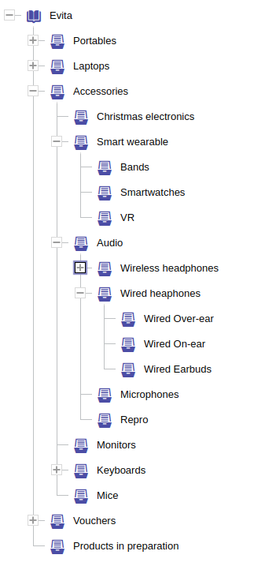

## Reference property

```evitaql-syntax
referenceProperty(
    argument:string!
    constraint:(traverseByEntityProperty|pickFirstByEntityProperty)?,
    constraint:orderingConstraint+
)
```

<dl>
    <dt>argument:string!</dt>
    <dd>
        a mandatory name of the reference whose attribute is to be used for the ordering
    </dd>
    <dt>constraint:(traverseByEntityProperty|pickFirstByEntityProperty)?</dt>
    <dd>
        optional constraint that specifies the way entities are sorted, see [`pickFirstByEntityProperty`](#pick-first-by-entity-property)
        and [`traverseByEntityProperty`](#traverse-by-entity-property) constraint documentation for more details
    </dd>
    <dt>constraint:orderingConstraint+</dt>
    <dd>
        one or more [ordering constraints](./natural.md) that specify the ordering by the reference attribute
    </dd>
</dl>

<Note type="info">

<NoteTitle toggles="false">

##### The `referenceProperty` is implicit in requirement `referenceContent`

</NoteTitle>

In the `orderBy` clause within the [`referenceContent`](../requirements/fetching.md#reference-content) requirement,
the `referenceProperty` constraint is implicit and must not be repeated. All attribute order constraints
in `referenceContent` automatically refer to the reference attributes, unless the [`entityProperty`](#entity-property)
container is used there.

</Note>

Sorting by reference attribute is not as common as sorting by entity attributes, but it allows you to sort entities
that are in a particular category or have a particular group specifically by the priority/order for that particular
relationship.

To sort products related to a "sale" group by the `orderInGroup` attribute set on the reference, you need to issue the
following query:

<SourceCodeTabs requires="evita_test/evita_documentation_tests/src/test/resources/META-INF/documentation/evitaql-init.java" langSpecificTabOnly>

[Query products in "sale" ordered by predecessor chain](/documentation/user/en/query/ordering/examples/reference/reference-attribute-natural.evitaql)
</SourceCodeTabs>

<Note type="info">

<NoteTitle toggles="true">

##### List of products in "sale" ordered by predecessor chain
</NoteTitle>

The example is based on a simple one-to-zero-or-one reference (a product can have at most one reference to a group
entity). The response will only return the products that have a reference to the "sale" group, all of which contain the
`orderInGroup` attribute (since it's marked as a non-nullable attribute). Because the example is so simple, the returned
result can be anticipated:

<LS to="e,j,c">

<MDInclude>[List of products in "sale" ordered by predecessor chain](/documentation/user/en/query/ordering/examples/reference/reference-attribute-natural.evitaql.md)</MDInclude>

</LS>

<LS to="g">

<MDInclude>[List of products in "sale" ordered by predecessor chain](/documentation/user/en/query/ordering/examples/reference/reference-attribute-natural.graphql.json.md)</MDInclude>

</LS>

<LS to="r">

<MDInclude>[List of products in "sale" ordered by predecessor chain](/documentation/user/en/query/ordering/examples/reference/reference-attribute-natural.rest.json.md)</MDInclude>

</LS>

</Note>

<Note type="warning">

<NoteTitle toggles="false">

##### Ordering of 1:N references

</NoteTitle>

Things can get more complicated when the reference is one-to-many. What should you expect when you run a query that 
involves sorting by a property on a reference attribute? Relational databases allow this, but you need to deal with 
the problem of row multiplication. With evitaDB, you work with an entity model, so you don't have to worry about 
the multiplication problem. It's possible, but there are some specifics because evitaDB supports hierarchical entities.

Let's break it down into two cases:

**Non-hierarchical entity**

If the referenced entity is non-hierarchical and the returned entity references multiple entities, only the reference 
with the lowest primary key of the referenced entity, while also having the order property set, will be used for ordering.
This is the same as if you had used the [`pickFirstByEntityProperty`](#pick-first-by-entity-property) constraint in 
your `referenceProperty` container:

```evitaql
pickFirstByEntityProperty(   
    primaryKeyNatural(ASC),   
)
```

**Hierarchical entity**

If the referenced entity is **hierarchical** and the returned entity references multiple entities, the reference used
for ordering is the one that contains the order property and is the closest hierarchy node to the root of the filtered
hierarchy node.

It sounds complicated, but it's really quite simple. Imagine you're listing products from a category and also sorting 
them by a property called `orderInCategory` on the category reference. The first products you get are the ones directly 
related to the category, in order of `orderInCategory`. Then you get the products from the first child category, and so
on, keeping the category tree's order. This is the same as using the [`traverseByEntityProperty`](#traverse-by-entity-property) 
constraint in your `referenceProperty` container:

```evitaql
traverseByEntityProperty(  
    DEPTH_FIRST,  
    primaryKeyNatural(ASC),    
)
```

**Note:**

You can control the behaviour by using the `pickFirstByEntityProperty` or `traverseByEntityProperty` constraints in your
`referenceProperty` container. You can also use the `traverseByEntityProperty` for non-hierarchical entities and for 1:1
references. It changes the order so that the entities are first sorted by the property of the thing they're referring to,
and then by the reference property itself. For more information, check out the examples and the detailed documentation 
of the [`traverseByEntityProperty`](#traverse-by-entity-property) constraint.

</Note>

## Pick first by entity property

```evitaql-syntax
pickFirstByEntityProperty(
    constraint:orderingConstraint+
)
```

<dl>
    <dt>constraint:orderingConstraint+</dt>
    <dd>
        one or more [ordering constraints](./natural.md) that specify the ordering of the references to pick the first
        one from the list of references to the same entity to be used for ordering by `referenceProperty`
    </dd>
</dl>

The `pickFirstByEntityProperty` ordering constraint can only be used within the [`referenceProperty`](#reference-property) ordering constraint.
It makes sense only in case the cardinality of the reference is 1:N (although this isn't actively checked by the query 
engine). This constraint lets you specify the order of the references to pick the first one from the list of references 
to the same entity to be used for ordering by `referenceProperty`.

The reference used for ordering an entity is picked by the following rules:

1. The references of the entity are considered in the order given by the `pickFirstByEntityProperty` constraints
   (by the primary key of the referenced entity in ascending order when the constraint is omitted). References to
   the same entity, which a reference with a cardinality allowing duplicates can hold, follow in the order of their
   representative attribute values.
2. The first reference that has a value of the ordering property is picked. References without the value are skipped,
   and an entity with no such reference is placed after all the ordered ones, where the next ordering constraint of
   the query decides its position.
3. A [`referenceHaving`](../filtering/references.md#reference-having) constraint targeting the same reference decides
   which entities are returned, but never which of their references are used for ordering. A filtered hierarchy does
   bound the eligible references: [`hierarchyWithin`](../filtering/hierarchy.md#hierarchy-within) or
   [`hierarchyWithinRoot`](../filtering/hierarchy.md#hierarchy-within-root) on the ordered reference follows the same
   scope, modifier and filter-container rules as [traverse ordering](#how-the-entities-are-placed) below. References
   outside that bound are skipped before picking the first valued reference.
4. Entities whose picked references have the same value are ordered by their primary key in the direction of
   the ordering (ascending for an ascending order, descending for a descending one), as with any other attribute.

These rules apply to attributes whose values can be compared with one another. Attributes of type
[`Predecessor`](../../use/data-types.md#predecessor) and `ReferencedEntityPredecessor` form chains within each
referenced entity and can only be ordered referenced entity by referenced entity, as the
[`traverseByEntityProperty`](#traverse-by-entity-property) constraint does.

<Note type="info">

<NoteTitle toggles="true">

##### Details: chains and exact ordering under pick-first

</NoteTitle>

When no `pickFirstByEntityProperty` is given and the ordered attribute is a chain, the chains follow the order of the
referenced entities, and then the order of the representative attribute values of references to the same entity. For
the same representative values, the chain of live entities precedes the chain of archived ones.

[`attributeSetExact`](./constant.md#exact-entity-attribute-value-order) under pick-first, and
[`attributeSetInFilter`](./constant.md#exact-entity-attribute-value-order-used-in-filter) inside any reference
ordering, work only when the query narrows the ordered reference down to a single referenced entity, for example by
filtering for it with `referenceHaving`. Otherwise the query fails with an error asking for exactly one index. The
block-by-block exact ordering of [`traverseByEntityProperty`](#how-the-entities-are-placed) has no such limit.

</Note>

Let's expand our previous example to include products that refer to both the "sale" and "new" groups:

<SourceCodeTabs requires="evita_test/evita_documentation_tests/src/test/resources/META-INF/documentation/evitaql-init.java" langSpecificTabOnly>

[Query products in groups "sale" or "new" ordered by predecessor chain](/documentation/user/en/query/ordering/examples/reference/reference-attribute-natural-multiple.evitaql)
</SourceCodeTabs>

<Note type="info">

<NoteTitle toggles="true">

##### List of products in groups "sale" or "new" ordered by predecessor chain
</NoteTitle>

<LS to="e,j,c">

<MDInclude>[List of products in groups "sale" or "new" ordered by predecessor chain](/documentation/user/en/query/ordering/examples/reference/reference-attribute-natural-multiple.evitaql.md)</MDInclude>

</LS>

<LS to="g">

<MDInclude>[List of products in groups "sale" or "new" ordered by predecessor chain](/documentation/user/en/query/ordering/examples/reference/reference-attribute-natural-multiple.graphql.json.md)</MDInclude>

</LS>

<LS to="r">

<MDInclude>[List of products in groups "sale" or "new" ordered by predecessor chain](/documentation/user/en/query/ordering/examples/reference/reference-attribute-natural-multiple.rest.json.md)</MDInclude>

</LS>

</Note>

The result will contain the first products from the "new" group, which has the lowest primary key. Then it will contain
the products from the "sale" group. The order of products within each group will be determined by the `orderInGroup` 
attribute. This is the usual way things are done for references that target non-hierarchical entities.

If we want to change the order of the groups, we can use the `pickFirstByEntityProperty` ordering constraint to explicitly
specify the order of the groups. For example, if we want to list products in the "sale" group first, we can use
the following query:

<SourceCodeTabs requires="evita_test/evita_documentation_tests/src/test/resources/META-INF/documentation/evitaql-init.java" langSpecificTabOnly>

[Query products in groups "sale" or "new" ordered by predecessor chain with explicit ordering](/documentation/user/en/query/ordering/examples/reference/reference-attribute-natural-multiple-explicit.evitaql)
</SourceCodeTabs>

<Note type="info">

<NoteTitle toggles="true">

##### List of products in groups "sale" or "new" ordered by predecessor chain with explicit group ordering
</NoteTitle>

<LS to="e,j,c">

<MDInclude>[List of products in groups "sale" or "new" ordered by predecessor chain with explicit group ordering](/documentation/user/en/query/ordering/examples/reference/reference-attribute-natural-multiple-explicit.evitaql.md)</MDInclude>

</LS>

<LS to="g">

<MDInclude>[List of products in groups "sale" or "new" ordered by predecessor chain with explicit group ordering](/documentation/user/en/query/ordering/examples/reference/reference-attribute-natural-multiple-explicit.graphql.json.md)</MDInclude>

</LS>

<LS to="r">

<MDInclude>[List of products in groups "sale" or "new" ordered by predecessor chain with explicit group ordering](/documentation/user/en/query/ordering/examples/reference/reference-attribute-natural-multiple-explicit.rest.json.md)</MDInclude>

</LS>

If a product is in both groups, the "sale" group takes priority and is used for ordering. You can use all sorts of 
ordering constraints and adjust the ordering to suit your needs.

</Note>

## Traverse by entity property

```evitaql-syntax
traverseByEntityProperty(
    argument:enum(DEPTH_FIRST|BREADTH_FIRST)?,
    constraint:orderingConstraint+
)
```

<dl>
    <dt>argument:enum(DEPTH_FIRST|BREADTH_FIRST)?</dt>
    <dd>
        optional argument that specifies the mode of the reference traversal, the default value is `DEPTH_FIRST`
    </dd>
    <dt>constraint:orderingConstraint+</dt>
    <dd>
        one or more [ordering constraints](./natural.md) that change the traversal order of the references of
        the ordered entity before the `referenceProperty` ordering constraint is applied
    </dd>
</dl>

The `traverseByEntityProperty` ordering constraint can only be used with the [`referenceProperty`](#reference-property)
ordering constraint. It sorts the returned entities first by the entities they reference, and only then by the value
of the reference property. If the referenced entity is hierarchical, you can specify whether the hierarchy should be
traversed in [depth-first](https://en.wikipedia.org/wiki/Depth-first_search) or
[breadth-first](https://en.wikipedia.org/wiki/Breadth-first_search) order.

### How the entities are placed

Think of the result as a sequence of *blocks*, one for each referenced entity. Two different things decide the order
of the result, and you control both of them:

- **The order of the blocks** is the order of the referenced entities. The ordering constraints inside
  `traverseByEntityProperty` sort them - by primary key, by an attribute of the referenced entity, and so on. For a
  hierarchical entity, the traversal mode also decides whether the children of a node follow it immediately
  (`DEPTH_FIRST`) or only after all the nodes of its level (`BREADTH_FIRST`).
- **The order inside a block** is decided by the ordering constraint that follows `traverseByEntityProperty` in
  `referenceProperty`, typically an attribute of the reference such as `orderInCategory`. Entities with the same value
  are ordered by their primary key in the direction of the ordering.

An entity may reference several entities, but it is returned only once. It is placed in the **first block, in the
order of the blocks, in which it has a reference with a value to sort by**. A reference without that value does not
place the entity, which then waits for a later block. Entities that no block can place come after all the blocks, in
the order given by the next ordering constraint of the query.

Only a hierarchy filter limits which referenced entities get a block:

- When the query filters by [`hierarchyWithin`](../filtering/hierarchy.md#hierarchy-within) or
  [`hierarchyWithinRoot`](../filtering/hierarchy.md#hierarchy-within-root) on the same reference, only the entities
  of the filtered part of the hierarchy get a block. A product listed in a category is then ordered within that
  category's subtree, even when it also belongs to a category that comes earlier in the tree.
- Without such a filter, every referenced entity gets a block. In particular,
  [`referenceHaving`](../filtering/references.md#reference-having) only selects which entities are returned: an
  entity can still be placed by its reference to an entity the filter did not ask for.

An entity can also reference the *same* entity several times, when the cardinality of the reference allows
duplicates. All these references fall into the block of that one referenced entity, and the entity is sorted by just
one of them: the reference with the lowest [representative attribute](../../use/schema.md#reference-cardinality)
values among those that have a value to sort by. No query constraint changes this choice - your data does: if one
particular reference should decide, give only that reference the attribute you sort by.

The following examples show each of these rules on a few products in this category tree, where the primary keys of
the categories are in parentheses:

```
Accessories (1)
├── Cables (2)
└── Cases (3)
Phones (4)
```

Unless stated otherwise, the examples order by `orderInCategory`, an attribute of the `categories` reference:

```evitaql
orderBy(
    referenceProperty(
        "categories",
        traverseByEntityProperty(DEPTH_FIRST, entityPrimaryKeyNatural(ASC)),
        attributeNatural("orderInCategory", ASC)
    )
)
```

<Note type="info">

<NoteTitle toggles="true">

##### Example: an entity in several categories, and the order of the blocks

</NoteTitle>

| Product | `orderInCategory` of its references |
|---------|-------------------------------------|
| A       | Cables: 2                           |
| B       | Accessories: 1, Phones: 1           |
| C       | Cables: 1, Phones: 2                |
| D       | Phones: 3                           |

With `DEPTH_FIRST`, the blocks follow the order Accessories, Cables, Cases, Phones:

- *Accessories* places B.
- *Cables* places C (1) and then A (2).
- *Cases* places nobody.
- *Phones* places D. B and C reference Phones as well, but they are already placed.

The result is **B, C, A, D**.

With `BREADTH_FIRST`, the root categories come first, so the blocks follow the order Accessories, Phones, Cables,
Cases. *Phones* now comes before *Cables* and places C (2) and D (3), so the result is **B, C, D, A**. The same data
gives a different result because the order of the blocks changed.

</Note>

<Note type="info">

<NoteTitle toggles="true">

##### Example: a reference without a value to sort by

</NoteTitle>

| Product | `orderInCategory` of its references |
|---------|-------------------------------------|
| A       | Cables: 1                           |
| E       | Cables: *(none)*, Phones: 2         |
| F       | Cases: *(none)*                     |

The query also orders by primary key after the reference:
`orderBy(referenceProperty("categories", ...), entityPrimaryKeyNatural(ASC))`.

- *Cables* places A. E references Cables too, but that reference has no `orderInCategory`, so E waits.
- *Phones* places E by its second reference.
- F has no reference with a value, so no block places it. It comes after all the blocks, ordered by primary key.

The result is **A, E, F**.

</Note>

<Note type="info">

<NoteTitle toggles="true">

##### Example: a hierarchy filter limits the blocks, `referenceHaving` does not

</NoteTitle>

| Product | `orderInCategory` of its references |
|---------|-------------------------------------|
| G       | Cables: 1, Cases: 3                 |
| H       | Cases: 2                            |

You list the products of the *Cases* category and want them in their order in that category.

With `filterBy(hierarchyWithin("categories", entityPrimaryKeyInSet(3)))`, only *Cases* gets a block. It places H (2)
and then G (3), so the result is **H, G**.

With `filterBy(referenceHaving("categories", entityPrimaryKeyInSet(3)))`, the same two products are returned, but every
category gets a block. *Cables* comes first and places G by its reference to Cables, and *Cases* places H, so the
result is **G, H**. G is ordered by its position in a category you did not ask for. To order the products of one
category by their order in that category, filter by `hierarchyWithin`.

</Note>

<Note type="info">

<NoteTitle toggles="true">

##### Example: several references to the same entity

</NoteTitle>

Here a product refers to the group *Sale* through a `groups` reference whose cardinality allows duplicates. Its
representative attribute `channel` tells the references apart, and the query orders by `orderInGroup`:

```evitaql
orderBy(
    referenceProperty(
        "groups",
        traverseByEntityProperty(entityPrimaryKeyNatural(ASC)),
        attributeNatural("orderInGroup", ASC)
    )
)
```

| Product | References to *Sale* (`channel`: `orderInGroup`) |
|---------|--------------------------------------------------|
| K       | `app`: 5, `web`: 1                               |
| L       | `web`: 2                                         |
| M       | `app`: *(none)*, `web`: 3                        |

The references of one product to *Sale* are tried in the order of their `channel` values, `app` before `web`, and the
first one with an `orderInGroup` is used:

- K is sorted by 5, from its `app` reference. Its `web` reference with 1 is not used.
- L is sorted by 2.
- M's `app` reference has no value, so M is sorted by 3, from its `web` reference.

The result is **L, M, K**. If the `web` references should decide, set `orderInGroup` only on them.

</Note>

<Note type="info">

<NoteTitle toggles="true">

##### Detailed rules

</NoteTitle>

The following rules describe the behaviour above precisely. An *owner* is an entity being returned; a *row* is one of
its references to a referenced entity, called a *target*. Both ways the engine can evaluate the query - by scanning
indexes or by sorting prefetched entities - follow the same rules, including pages that cross block boundaries.

1. The filtered hierarchy bounds the traversal. A [`hierarchyWithin`](../filtering/hierarchy.md#hierarchy-within) or
   [`hierarchyWithinRoot`](../filtering/hierarchy.md#hierarchy-within-root) on the ordered reference supplies its
   resolved node set, including [`excluding`](../filtering/hierarchy.md#excluding),
   [`excludingRoot`](../filtering/hierarchy.md#excluding-root), [`having`](../filtering/hierarchy.md#having),
   [`anyHaving`](../filtering/hierarchy.md#any-having) and
   [`directRelation`](../filtering/hierarchy.md#direct-relation). For a reference, `hierarchyWithin(..., directRelation())` admits the parent nodes themselves. The constraint must
   be reached from [`filterBy`](../basics.md#filter-by) through [`and`](../filtering/logical.md#and),
   [`inScope`](../filtering/behavioral.md#in-scope) or [`userFilter`](../filtering/behavioral.md#user-filter);
   constraints under [`or`](../filtering/logical.md#or) or [`not`](../filtering/logical.md#not) do not bound the
   traversal. A bound inside `inScope` applies only to that scope; other scopes stay unbounded unless they have their
   own bound. Multiple conjunctive hierarchy constraints contribute the union of their node sets, because each can be
   satisfied by a different row. Without a qualifying hierarchy constraint, every target referenced in the scopes the
   ordering processes is eligible. [`referenceHaving`](../filtering/references.md#reference-having) selects owners and
   never narrows the traversal; [`facetHaving`](../filtering/references.md#facet-having) does not narrow it either.
2. There is one block per target. It holds every row to that target, whatever its representative attributes, from
   the scopes the ordering processes. An [`inScope`](./behavioral.md#in-scope) ordering leaves owners of other scopes
   for the next sorter. A target is visited in the hierarchy tree of its own scope, live tree before archived tree,
   even when its owners have a different scope. The nested target ordering uses the targets the traversal visits,
   including ancestors needed for the hierarchy walk; it does not shrink to the targets of the selected owners.
3. In each block, an owner is represented by its first row to that target that carries the value being ordered. The
   rows of one owner to one target are tried in ascending order of their representative attribute values. A row
   without the value passes the owner on to another row. Owners are ordered by their representing values, with ties
   broken by owner primary key in the ordering direction. Owners of different scopes are merged by those same rules.
   For [`entityPrimaryKeyNatural`](./comparable.md#primary-key-natural), all owners in a block share the target's
   primary key, so their own primary keys decide the order in the requested direction.
4. An owner with no valued row for a nested sorter passes to the next nested sorter in the block. So does an owner
   outside the scopes of an `inScope` container wrapping that sorter, and an owner of a scope that does not index the
   ordered [sortable attribute compound](../../use/schema.md#sortable-attribute-compounds). If no nested sorter can
   place it, it remains for later blocks. An owner placed in one block is returned only once; one placed by no block
   goes to the next ordering constraint after the traverse. These rules also apply to a block holding a single owner.
5. [`attributeSetExact`](./constant.md#exact-entity-attribute-value-order) works block by block. It uses the first
   valued row from rule 3, including when that row's value is unlisted and a later row has a listed value. Listed
   values come first in the listed order, with ties by ascending owner primary key. An unlisted or missing value
   passes the owner to the next nested sorter and, if still unplaced, to later blocks. A block without any value of
   the attribute claims nothing.
6. [`Predecessor`](../../use/data-types.md#predecessor) chains keep their chain order within each block. When rows
   with different representative attribute values contribute chains, the first row that a chain can place represents
   the owner: lower representative values precede higher ones, and for the same values the live chain precedes the
   archived chain.

</Note>

This behaviour is best illustrated by the following example. Let's list products in the 'Accessories' category in order
of the `orderInCategory` attribute on the category reference:

<SourceCodeTabs requires="evita_test/evita_documentation_tests/src/test/resources/META-INF/documentation/evitaql-init.java" langSpecificTabOnly>

[Query products in "Accessories" category ordered by predecessor chain](/documentation/user/en/query/ordering/examples/reference/reference-attribute-natural-hierarchy.evitaql)

</SourceCodeTabs>

<Note type="info">

<NoteTitle toggles="true">

##### List products in "Accessories" category ordered by predecessor chain

</NoteTitle>

<LS to="e,j,c">

<MDInclude>[List products in "Accessories" category ordered by predecessor chain](/documentation/user/en/query/ordering/examples/reference/reference-attribute-natural-hierarchy.evitaql.md)</MDInclude>

</LS>

<LS to="g">

<MDInclude>[List products in "Accessories" category ordered by predecessor chain](/documentation/user/en/query/ordering/examples/reference/reference-attribute-natural-hierarchy.graphql.json.md)</MDInclude>

</LS>

<LS to="r">

<MDInclude>[List products in "Accessories" category ordered by predecessor chain](/documentation/user/en/query/ordering/examples/reference/reference-attribute-natural-hierarchy.rest.json.md)</MDInclude>

</LS>

The result will first contain products in the *Accessories* category, ordered by `orderInCategory` from most to least, 
then products in the *Christmas electronics* category (which is the first child of the *Accessories* category with 
the least primary key), then products in the *Smart wearable* category (which has no directly related products), 
then products in the *Bands* category (which is the first child of the *Smart wearable* category), and so on.
The order follows the order of the categories in the following image:



If a product falls into both the **Christmas** electronics and **Smart wearable** categories, it will only be listed 
once. This is because, in this query, the category's primary key is used to traverse the hierarchy.

</Note>

Here's another example: we want to list products in the *Accessories* category in a certain order. This order is based
on the `orderInCategory` attribute on the reference to the category. But we want to go through the hierarchy using
[breadth first manner](https://en.wikipedia.org/wiki/Breadth-first_search), where each hierarchy level should be sorted
by category `order` attribute first:

<SourceCodeTabs requires="evita_test/evita_documentation_tests/src/test/resources/META-INF/documentation/evitaql-init.java" langSpecificTabOnly>

[List products breadth first by order in category in category order](/documentation/user/en/query/ordering/examples/reference/reference-traverse-by.evitaql)

</SourceCodeTabs>

<Note type="info">

<NoteTitle toggles="true">

##### Result of listing products by order in category in breadth first category order
</NoteTitle>

<LS to="e,j">

<MDInclude sourceVariable="recordData">[Result of listing products by order in category in breadth first category order](/documentation/user/en/query/ordering/examples/reference/reference-traverse-by.evitaql.json.md)</MDInclude>

</LS>

<LS to="g">

<MDInclude>[Result of listing products by order in category in breadth first category order](/documentation/user/en/query/ordering/examples/reference/reference-traverse-by.graphql.json.md)</MDInclude>

</LS>

<LS to="r">

<MDInclude>[Result of listing products by order in category in breadth first category order](/documentation/user/en/query/ordering/examples/reference/reference-traverse-by.rest.json.md)</MDInclude>

</LS>

As you can see, you can arrange the order of the entities and the references within the hierarchy however you want.

</Note>

## Entity property

```evitaql-syntax
entityProperty(
    constraint:orderingConstraint+
)
```

<dl>
    <dt>constraint:orderingConstraint+</dt>
    <dd>
        one or more [ordering constraints](./natural.md) that specify the ordering by the referenced entity attributes
    </dd>
</dl>

The `entityProperty` ordering constraint can only be used within the [`referenceContent`](../requirements/fetching.md#reference-content)
requirement. It allows to change the context of the reference ordering from attributes of the reference itself to
attributes of the entity the reference points to.

In other words, if the `Product` entity has multiple references to `ParameterValue` entities, you can sort those
references by, for example, the `order` or `name` attribute of the `ParameterValue` entity. Let's see an example:

<SourceCodeTabs requires="evita_test/evita_documentation_tests/src/test/resources/META-INF/documentation/evitaql-init.java" langSpecificTabOnly>

[Get product with parameters ordered by their priority](/documentation/user/en/query/ordering/examples/reference/entity-property.evitaql)
</SourceCodeTabs>

<Note type="info">

<NoteTitle toggles="true">

##### Get product with parameter values ordered by their name
</NoteTitle>

<LS to="e,j">

<MDInclude sourceVariable="recordData.0">[Get product with parameters ordered by their name](/documentation/user/en/query/ordering/examples/reference/entity-property.evitaql.json.md)</MDInclude>

</LS>

<LS to="g">

<MDInclude>[Get product with parameters ordered by their name](/documentation/user/en/query/ordering/examples/reference/entity-property.graphql.json.md)</MDInclude>

</LS>

<LS to="r">

<MDInclude>[Get product with parameters ordered by their name](/documentation/user/en/query/ordering/examples/reference/entity-property.rest.json.md)</MDInclude>

</LS>

</Note>

## Entity group property

```evitaql-syntax
entityGroupProperty(
    constraint:orderingConstraint+
)
```

<dl>
    <dt>constraint:orderingConstraint+</dt>
    <dd>
        one or more [ordering constraints](./natural.md) that specify the ordering by the referenced entity group
        attributes
    </dd>
</dl>

The `entityGroupProperty` ordering constraint can only be used within the [`referenceContent`](../requirements/fetching.md#reference-content) requirement. It
allows the context of the reference ordering to be changed from attributes of the reference itself to attributes of
the group entity within which the reference is aggregated.

In other words, if the `Product` entity has multiple references to `ParameterValue` entities that are grouped by their
assignment to the `Parameter` entity, you can sort those references primarily by the `name` attribute of the grouping
entity, and secondarily by the `name` attribute of the referenced entity. Let's look at an example:

<SourceCodeTabs requires="evita_test/evita_documentation_tests/src/test/resources/META-INF/documentation/evitaql-init.java" langSpecificTabOnly>

[Get product with parameters ordered by their group name and name](/documentation/user/en/query/ordering/examples/reference/entity-group-property.evitaql)

</SourceCodeTabs>

<Note type="info">

<NoteTitle toggles="true">

##### Get product with parameters ordered by their priority
</NoteTitle>

<LS to="e,j,c">

<MDInclude sourceVariable="recordData.0">[Get product with parameters ordered by their group name and name](/documentation/user/en/query/ordering/examples/reference/entity-group-property.evitaql.json.md)</MDInclude>

</LS>

<LS to="g">

<MDInclude>[Get product with parameters ordered by their group name and name](/documentation/user/en/query/ordering/examples/reference/entity-group-property.graphql.json.md)</MDInclude>

</LS>

<LS to="r">

<MDInclude>[Get product with parameters ordered by their group name and name](/documentation/user/en/query/ordering/examples/reference/entity-group-property.rest.json.md)</MDInclude>

</LS>

</Note>
